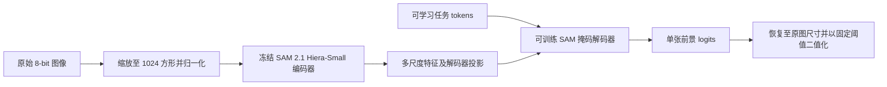

# 自动分割基线

当前仓库维护这条自动分割路径，适用于息肉、血管等单任务二值分割。

- `model.py`：不调用官方 inference predictor，避免 inference mode 截断训练梯度。
- SAM 的 `forward_image` 同时包含冻结编码器和可训练的 decoder feature projections，因此不能把整个函数放进 `no_grad()`。
- 图像编码器、提示编码器、视频记忆相关权重冻结。任务 token 和掩码解码器可训练。视频记忆不参与计算。
- 掩码质量分支、对象存在分支没有额外监督，也不参与输出选择或门控。输出使用单掩码 token，不选择“与真值最好”的候选掩码。
- 单任务固定语义；同一次训练中不能混合互相冲突的目标定义。多任务条件化还未实现。
- 训练只用最近邻缩放后的二值标签计算 BCE + soft Dice；验证和测试在原图网格计算指标。
