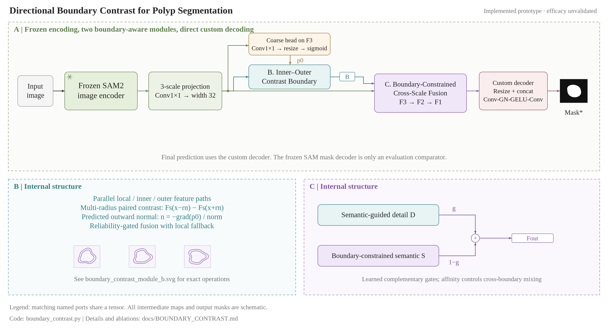
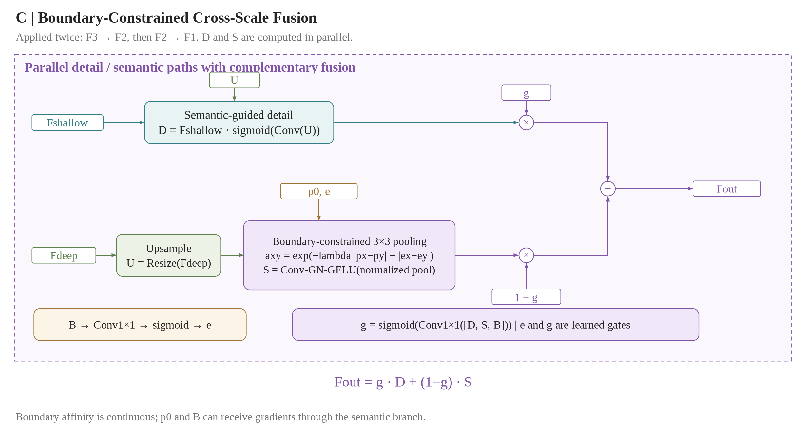

# 内外对照边界与边界约束跨尺度融合（当前研究分支）

状态：实现完成，研究原型。没有完整息肉数据集的训练结果；不能声称已经改善边界、泛化或达到 SOTA，也没有完成新颖性检索。
可编辑 PPTX 通过 [cell_su7](https://github.com/yrui-cmd/cell_su7) 从自绘 SVG 导出；未使用付费识图或去水印 API。

旧的区域—形状方案保留在 `region_shape.py`，二者互不替代检查点；本方案不使用隐式形状候选、文本或 SAM 稠密/稀疏提示适配。



[矢量 SVG](figures/boundary_contrast.svg) · [矢量 PDF](figures/boundary_contrast.pdf) · [三页可编辑 PPTX](figures/boundary_contrast_all.pptx)

## 独立模块图




绘图源文件：`tools/draw_boundary_contrast.py`。可选安装 `cairosvg` 后运行，重新生成三组 SVG/PNG/PDF，不改变训练依赖。图中使用同名端口减少长线交叉。

## 1. 问题、模块与可检验的贡献

### 模块 B：内外对照边界模块（Inner–Outer Contrast Boundary Module）

问题假设：息肉与邻近黏膜外观相似时，单点特征不足以区分目标边缘两侧。

- 冻结 SAM2 产生三尺度特征，分别用 1×1 卷积投影至 32 通道。
- 深层投影特征经过可训练粗分割头生成 logit，再上采样并 sigmoid 得到 `p0`。
- 浅层与上采样中层投影特征取均值，作为边界模块输入 `F_s`。
- 局部分支：深度 3×3 卷积 → 1×1 卷积 → GroupNorm → GELU。
- 几何分支：由于 p0 在目标内部较大，**外法向取负梯度** `n = -∇p0 / sqrt(|∇p0|² + 1e-12)`。
- 在特征网格上以 r∈{1,2,4} 像素，配对采样 `F_s(x-rn)` 与 `F_s(x+rn)`；其差值拼接后经 1×1 卷积、GN、GELU 编码。
- 可靠性 `rho = |∇p0|² / (|∇p0|² + s²)`，乘各半径有效区域的均值；用固定保守半径边缘范围抑制图外采样，避免浮点误差引发边缘有效性跳变。
- `a = rho * sigmoid(Conv([local, contrast, rho]))`，`B = (1-a)*local + a*contrast`。方向不可靠时退回局部分支；没有 GT 法向或 GT 边界输入。

**可写入方法草稿的贡献候选：**设计一种预测几何条件化的内外成对采样模块，在多个距离上比较边界两侧特征，并以方向可靠性调节其与局部细节的融合。

限制：粗预测错误会让方向错误；低梯度的平滑假阴性区域可能根本没有可靠方向。本模块不能凭空恢复所有漏检目标，方向可靠性也不是经过校准的不确定性。

### 模块 C：边界约束跨尺度融合（Boundary-Constrained Cross-Scale Fusion）

问题假设：深层特征上采样后缺少边界细节，直接融合可能跨越目标边缘混合特征。

按 F3→F2→F1 逐级融合；每对尺度内部**并行**计算：

1. 语义引导细节：`D = F_shallow * sigmoid(Conv1x1(U(F_deep)))`。
2. 边界约束语义：将 B 投影为标量门控 `e = sigmoid(Conv1x1(B))`。对上采样深层特征执行 3×3 邻域归一化聚合：
   `a_xy = exp(-lambda*|p0(x)-p0(y)| - |e(x)-e(y)|)`，
   `A(x) = Σ_y a_xy U(F_deep)(y) / Σ_y a_xy`；之后 Conv3×3 → GN → GELU 得到 S。
3. 竞争融合：`g = sigmoid(Conv1x1([D,S,B]))`，`F_out = g*D + (1-g)*S`。

边界约束来自**预测概率差和学习的边界门控差**，不是对原始特征做硬切割。此处“语义引导”表示深层视觉特征，不涉及文本。

**可写入方法草稿的贡献候选：**在跨尺度融合中构建语义引导细节与边界约束语义两条并行路径，以预测边界相关的邻域亲和度控制特征传播，并通过互补门控融合两路结果。

限制：跨边界抑制也可能保留粗预测错误；需与普通局部平滑、无约束融合以及参数/计算匹配结构比较。

### 与所读 WeakPolyp-SAM 的关系

[WeakPolyp-SAM, KBS 2025](https://doi.org/10.1016/j.knosys.2025.113701) 使用 CFM/LCD 和涂鸦监督、SAM 在线伪标签协作训练。本分支只是借鉴“具体问题对应结构模块”的研究组织方式；没有移植 CFM/LCD，也没有实现其弱监督协议。我们的当前任务仍是完整掩码监督。不能用该论文的结果为本分支的新颖性或性能背书。

### 最终解码与训练

将三个投影/细化尺度上采样到最细特征网格并拼接，使用独立 Conv3×3→GN→GELU→Conv1×1 解码，logit 上采样到输入分辨率。

- **没有使用 SAM 掩码解码器生成本分支的最终预测，也没有 baseline logit 残差相加。**
- 冻结整个已训练基线（包含官方编码器、`conv_s0/conv_s1`、原掩码解码器和 task tokens）。可训练参数仅在新 head 内。
- 训练/新分支预测每图 1 次编码 + 1 次自定义解码；配对评估额外用同一份特征调用一次冻结的基线 SAM 解码器。
- 损失：最终分割 BCE+Dice，加 `0.2 ×` 粗分割 BCE+Dice。粗 logit 上采样到标签网格计算损失，避免降采样标签抹去小目标。遵守 valid/FOV；没有额外边界标签或边界损失。
- 新解码器是随机初始化，**初始输出不等于已有基线**。因此与基线的增益不能自动归因于两个模块，必须包含同一新解码器的对照。
- Radii 单位是最细特征图像素；默认 1024 输入、256 最细特征网格时约对应原模型输入的 4、8、16 像素，不是原图天然物理尺寸。

## 2. 在 4090 上运行

继续使用已有 `light` 配置和自己的**息肉**基线权重。不同任务权重不要混用。

先验证小样本可学习性（只取训练数据，不作为正式模型或性能证据）：

```bash
medsam probe-boundary-contrast \
  --config configs/polyp_full_aug.yaml \
  --baseline-checkpoint outputs/polyp_baseline_full_aug_seed42/best.pt \
  --mechanism-config configs/boundary_contrast.yaml \
  --output outputs/polyp_bc_probe_seed42 --steps 100 --samples 2 --learning-rate 0.001
```

检查 `probe.json` 中训练损失、训练 Dice 以及 `head.boundary`、`head.fusions`、`head.coarse` 梯度。尚未提供固定的通过阈值，不应只看单个指标微升。

正式先跑 30 轮筛查：

```bash
medsam train-boundary-contrast \
  --config configs/polyp_full_aug.yaml \
  --baseline-checkpoint outputs/polyp_baseline_full_aug_seed42/best.pt \
  --mechanism-config configs/boundary_contrast.yaml \
  --output outputs/polyp_bc_full_seed42 --epochs 30
```

继承 YAML 中训练 LR、batch size、AMP、增强和种子；probe 的 `0.001` **不会**自动覆盖正式训练 LR。若显存不足，降低复制后的配置里的 batch size。当前环境只做 CPU/API 检查，尚未测量 4090 显存。

按验证集决定是否追加独立、预先设定的 100 轮实验，不使用五个测试集选轮数或超参。不支持断点续训，延长轮数需要新输出目录重新训练，不能把两次运行冒充同一次连续训练。

```bash
medsam evaluate-boundary-contrast \
  --config configs/polyp_full_aug.yaml \
  --baseline-checkpoint outputs/polyp_baseline_full_aug_seed42/best.pt \
  --checkpoint outputs/polyp_bc_full_seed42/best_boundary_contrast.pt \
  --manifest data/your_held_out_test.csv --output outputs/polyp_bc_test_seed42

medsam predict-boundary-contrast \
  --config configs/polyp_full_aug.yaml \
  --baseline-checkpoint outputs/polyp_baseline_full_aug_seed42/best.pt \
  --checkpoint outputs/polyp_bc_full_seed42/best_boundary_contrast.pt \
  --manifest data/your_unlabeled.csv --output outputs/polyp_bc_predictions_seed42
```

`best_boundary_contrast.pt` 绑定 baseline SHA256、结构配置、评估阈值和训练数据审计指纹；不能用基线 `evaluate` 误加载。输出配对 Dice/IoU/Boundary F1/precision/recall、逐图改正/新增错误统计、粗预测方向与可靠性诊断。指标遵循项目固定阈值协议；并非自动复现每篇论文的指标工具。

## 3. 必须补齐的对照

复制 `configs/boundary_contrast.yaml`，只改变 `mode`，其他数据/预算/初始化种子相同：

| mode | 移除什么 | 检验什么 |
|---|---|---|
| full | 无 | 完整原型 |
| no_contrast | B 仅使用局部分支 | 定向内外对照是否有贡献 |
| no_constraint | 语义路径不做边界亲和度聚合 | 邻域约束是否有贡献 |
| equal_fusion | g 固定 0.5 | 学习互补门控是否必要 |
| no_boundary | B=0，同时关闭语义邻域约束 | 同一新解码器的粗略无边界对照 |

这些消融没有严格匹配实际计算，部分参数会不参与 forward，不能称为参数/算力匹配对照。还需普通 3×3 平滑、非定向同预算采样、更强常规 FPN 头等对照；当前尚未实现。完成多种子与跨域测试前，不写“首次”“显著提高泛化”“解决边界模糊”或“SOTA”。

论文的合理结构是“问题假设 → 模块 → 计算规则 → 对照结果”，不是用模块名称替代新颖性证据。需进一步检索定向边界采样、双侧特征对比、边缘感知亲和度/双边滤波及跨尺度门控相关工作。

## 4. 实现检查记录（2026-11-19）

- 本次全量 `pytest -q`：66 项通过；Ruff、diff 检查及依赖一致性检查通过。CPU bf16 autocast 前后向通过；不等价于 4090 CUDA 性能验证。
- 检查了法向符号与特征网格采样距离、低梯度回退、保守边缘有效域、邻域约束的跨边界混合、梯度链和无 logit 残差。
- 流程测试覆盖训练、绑定检查点重载、配对评估、无标签预测、训练集探针、无效标签忽略。
- 真实官方 SAM2 Small 64 输入检查了基线参考复现、批量/逐图一致性和冻结参数。
- 真实官方 Small 预训练权重、1024 输入、CPU、3 张仓库自带 Kvasir 示例，完成 1 轮训练、重载、评估、无标签预测和 2 步探针。此处基线是带随机 task token 的 API 检查权重，**不是用户训练好的息肉基线**；不报告其 Dice 作为研究效果证据。
- 尚未进行完整数据集训练、4090 CUDA/bf16 显存和吞吐测试、跨数据集评估、多种子实验或新颖性证明。

最初讨论的概念图保存在 [initial_concept.png](figures/boundary_contrast_initial_concept.png)；图中的“not yet implemented”是绘制当时的状态，部分算子为概念简写。当前实现以本页公式、代码和上方重新生成的结构图为准。
