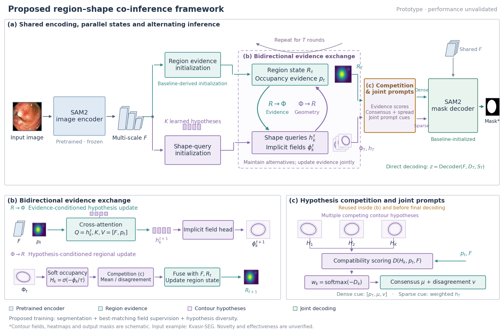

> 当前继续维护 region-shape。新增可选[窗口竞争与候选诊断](REGION_SHAPE_WINDOW.md)；原整图默认配置和旧检查点保持支持。

# V3区域—轮廓交替推断：实现与运行

这是我们自己的独立研究原型，不是已验证有效或已确认新颖的方法。原SAM2＋light训练、权重和命令保留。模型由已有的息肉基线初始化，不另训练随机BID，不加载文本模型。



## 图与代码的对应

- 图(a)的共享编码和初始区域证据：`RegionShapeSAM2.forward_details`调用已有基线的`forward_with_pyramid`，一次编码获得F1/F2/F3和初始logits。初始logits只用于初始化区域状态。
- 图(b)的双向交互：`RegionShapeHead.forward`。区域→轮廓使用query cross-attention；轮廓→区域使用加权占据均值和分歧，再更新区域状态。
- 图(c)的竞争与联合提示：`RegionShapeHead.competition`及`RegionShapeSAM2`的dense/sparse prompt生成。这一算子在每轮聚合及最后提示生成中复用。
- 最终输出：直接调用SAM2 mask decoder并恢复输入分辨率，**没有`z0 + Δz`，没有将原预测概率与最终概率加权平均**。Transformer内部的常规特征残差及任务token条件化不属于分割结果残差。

## 一次前向的张量与运算

默认1024输入；已投影SAM2金字塔为32×256²、64×128²、256×64²。新模块将各层投影到64通道，在64×64网格融合；高分辨率特征仍直接提供给最终SAM2解码器。网格、通道、假设数和轮数可配置。

1. 初始区域logits为基线预测缩放到机制网格，随后取sigmoid得到p。K=4个可学习query表示轮廓假设；坐标编码提供位置线索。
2. 区域→轮廓：Q为K个query，K/V来自融合的视觉特征与当前区域概率。cross-attention和前馈层更新query。query与空间特征点积后经tanh，输出K张范围[-1,1]的隐式场φ。H=sigmoid(-φ/τ)，默认τ=0.2。隐式场不强制星凸或单连通形状，也不保证严格满足距离场性质。
3. 竞争：每个H池化内部与外部特征，结合query、内外差异、占据面积及与p的交叉熵一致性，由小MLP产生兼容性能量D。w=softmax(-D)，随后计算μ=ΣwH，v=Σw(H-μ)²。与p一致仅是一项信号，不代表p正确；v是学习假设间的分歧，不宣称为校准的贝叶斯不确定性。
4. 轮廓→区域：卷积/GELU/GroupNorm融合F、p、μ和v，输出新的区域logits。默认交替2轮，参数跨轮共享。最后针对最终区域状态重新计算竞争，避免使用上一轮的陈旧分数。
5. 联合解码：三通道[p,μ,v]映射到SAM2稠密prompt embedding；已有任务token查询轮廓query，竞争权重作为注意力先验，生成稀疏prompt条件。最终SAM2解码器接收共享F和两类prompt，直接生成掩码。

默认冻结整套已训练基线，包括原任务token与mask decoder，只训练217,155个新参数（默认Small、64宽度、4假设、2轮）。`train_decoder: true`可另行解冻decoder及其高分辨率投影，但会改变可训练参数、预算和对照要求。图像编码器始终冻结。

## 保持基线能力的初始化

最后一层稠密prompt投影的权重为0、bias为原no-mask embedding；稀疏条件投影为0，因此FP32初始化时的最终预测等于基线。它是解码器提示的初始化，不是输出mask的残差相加。

这种初始化使部分上游prompt路径在第1步没有最终分割梯度；区域、场和共识辅助监督提供早期学习信号。日志分别记录各组梯度，不能把第一步task_query梯度为0直接解释为断链。验证选模包含第0轮；若始终没有超过初始化，明确报告best_epoch=0。

## 监督目标与标签边界

主损失是项目原有BCE＋Dice。另有：

- 每轮区域辅助分割，权重0.1。
- 最佳匹配假设的场L1，权重0.1。训练标签先在有效区清理，再max-pool到机制网格以保留小目标覆盖，生成带符号距离并按8个网格像素截断归一化；负值为内部。全空/全满分别定义为+1/-1。
- 加权共识占据的分割监督，权重0.1。
- 边界带内轻量假设防塌缩约束，权重0.01，差异margin=0.05。它是先验正则，不代表所有假设都是有效人工标注；也可能产生无用差异，必须做消融。

场目标、最佳匹配选择、训练标签只出现在`region_shape_loss`；推理forward仅接受图像，不使用标签、真值距离场或真值选假设。FOV外标签不会影响损失。max-pool会扩大极小区域在粗网格中的占据，不能当作精确面积；粗网格FOV/边界也存在离散化近似。最终主监督仍使用完整模型网格。

## 第一步：两张训练图拟合探针

使用你已训练好的light基线，并保留原官方Small权重。配置中的清单必须指向实际数据。

```bash
git pull
pip install -e ".[dev]"
medsam probe-region-shape --config configs/polyp_full_aug.yaml --baseline-checkpoint outputs/polyp_baseline_full_aug_seed42/best.pt --mechanism-config configs/region_shape.yaml --output outputs/polyp_rs_probe_seed42 --steps 100 --samples 2
```

探针仅取训练集前2图、关闭增强，默认AdamW lr=0.001，用于确认新路径能否拟合，不参与正式模型选择。输出probe.json、逐步各损失和梯度、初末训练集指标及状态图；不导出可误当正式模型的权重。两个不同样本的相邻step损失不能直接当同图拟合曲线，应比较同一小集合的初末指标。若最终分割没有学习，先诊断prompt、区域与场的信号，暂停正式消融。

## 第二步：本机1轮运行检查

```bash
medsam train-region-shape --config configs/polyp_full_aug.yaml --baseline-checkpoint outputs/polyp_baseline_full_aug_seed42/best.pt --mechanism-config configs/region_shape.yaml --output outputs/polyp_rs_smoke_seed42 --epochs 1
```

默认冻结基线、AdamW沿用基础配置lr=1e-4和weight_decay=0.01、同一light增强、种子和清单。CUDA下沿用BF16优先/FP16回退与梯度裁剪；FP16使用GradScaler。CPU关闭AMP。GPU实际显存和速度需本机检查，本环境没有4090。

## 第三步：正式预算与消融

新目录运行30轮（基础配置也是30轮）：

```bash
medsam train-region-shape --config configs/polyp_full_aug.yaml --baseline-checkpoint outputs/polyp_baseline_full_aug_seed42/best.pt --mechanism-config configs/region_shape.yaml --output outputs/polyp_rs_full_seed42 --epochs 30
```

训练源基线已经有原始训练预算，新机制阶段属于额外训练，不能仅凭同样30轮称与从头基线预算相同。正式论文需要相应的额外训练/参数与计算预算对照。

复制`configs/region_shape.yaml`到新文件并使用新输出目录，分别设置：

| 设置 | 含义 |
| --- | --- |
| mode: full | 完整双向交互与竞争 |
| mode: no_exchange | 不更新区域和query状态，保留初始区域证据及基于F的场/提示；中间部分参数不激活 |
| mode: uniform_competition | 竞争权重固定1/K |
| mode: region_only | 移除预测中的轮廓反馈和稀疏形状条件，使用区域提示；场/共识/多样性辅助损失关闭 |
| hypotheses: 1 | 单假设，无多样性损失与跨假设分歧 |

以上是机制消融，不是严格的有效参数量匹配对照；未激活参数不能计作有效容量。各模式辅助项不同，总训练loss也不能直接排序。后续仍需普通参数匹配头对照及多种子实验，才能论证机制贡献。

输出包括initial_validation.json、history.jsonl、best_region_shape.pt、last_region_shape.pt、training_summary.json。记录baseline和官方权重SHA、机制配置、数据身份、精度、代码版本、梯度、耗时和显存；同名输出目录拒绝覆盖。

## 固定评估与无标注推理

```bash
medsam evaluate-region-shape --config configs/polyp_full_aug.yaml --baseline-checkpoint outputs/polyp_baseline_full_aug_seed42/best.pt --checkpoint outputs/polyp_rs_full_seed42/best_region_shape.pt --manifest data/polyp_test/ETIS-LaribPolypDB_dedup.csv --output outputs/polyp_rs_etis_seed42
medsam predict-region-shape --config configs/polyp_full_aug.yaml --baseline-checkpoint outputs/polyp_baseline_full_aug_seed42/best.pt --checkpoint outputs/polyp_rs_full_seed42/best_region_shape.pt --manifest data/polyp/inference.csv --output outputs/polyp_rs_predictions_seed42
```

测试清单需预先审计；上述dedup名称仅示例，不意味着现有prepare脚本已经实现去重。评估使用保存的源训练/验证清单检查重叠并核验原始数据指纹；源文件需要可访问。相同验证清单可固定重评，复制成其他路径的重复样本不能伪装为外部测试。预测清单只需id,image，不读取mask/FOV列，也不依赖源训练标签。

结果报告baseline与region_shape两组固定阈值原图指标，包括Dice、IoU、Boundary F1、Precision、Recall及前景比例；paired_changes.csv记录纠正像素、新损伤、补回前景和新增假阳性。states.npz保存浮点隐式场/占据/共识/分歧，states.json记录假设权重、熵和面积，便于检查假设塌缩。已有HSNet评估工具中的去重衔接/指标聚合问题不由本次机制代码修复。

新权重与基线权重是不同格式，必须用对应命令。加载绑定原baseline checkpoint哈希和评估阈值；不支持优化器断点续训。原baseline best.pt不被覆盖，原命令继续可用。

## 已完成的验证

- 真实SAM2架构64输入：初始化等价、batch/逐图一致、稀疏prompt和query梯度、冻结编码器；可选decoder微调时高分辨率投影梯度。
- 流程夹具：训练、保存、重载、固定评估、无标注预测、探针、错误baseline拒绝、数据指纹变化拒绝。
- 真实官方Small权重1024输入：两张Kvasir训练样本、一张验证样本完成1轮、重载评估、无标注预测与2步探针。测试起点是官方权重＋随机task-token构造的API基线，**不是用户训练好的息肉基线**；该次验证选中了第0轮，不能说明方法有效。

没有验证息肉精度收益、4090运行效果或新颖性。hypothesis分歧不自动等于可靠不确定性，冻结特征也可能缺少目标证据；这些是需要由实际实验判定的限制。
