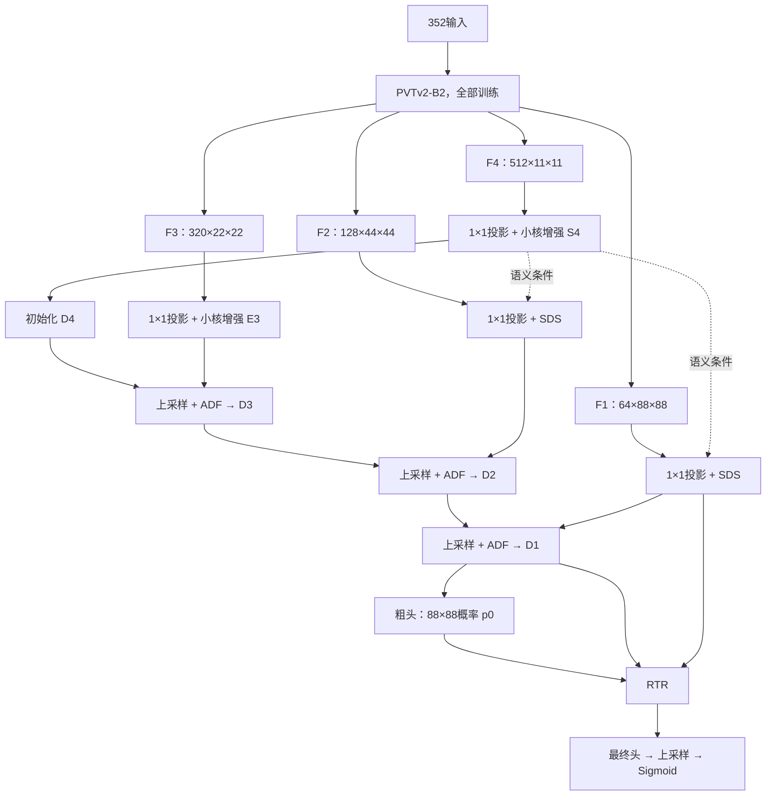

# SDS + ADF + RTR：最新三模块设计实现

这是待验证的新实验架构，不是已取得提升的模型。原版Polyp-PVT作为主基线；
旧SCSI/BCSC配置和结果保留，不会被覆盖。不要把新配置与旧subband配置混用。

## 结构与设计图对应



保留编码器，原CIM/CFM/相似性聚合模块全部移除。默认投影宽度64。

### ① SDS：语义条件尺度—方向选择

只在F1/F2对应网格使用DW3×3、DW5×5、DW7×7、DW1×7、DW7×1五分支。
`Concat[X,Resize(S4)]→1×1→GELU→1×1→五分支Softmax`生成逐位置权重，
加权后与X拼接，经通道MLP输出。不是全图统一权重。
F3/F4仅用DW3×3+1×1，避免最粗层堆叠大核。

### ② ADF：一致—分歧融合

细层X与上采样深层Y分别投影。定义逐位置通道余弦关系a=(1+cos)/2，d=1−a。

- 一致路径：`Concat[X⊙Y,X+Y]→Conv3×3→GELU`。
- 分歧路径：`Concat[X−Y,|X−Y|]→DW3×3→GELU→通道MLP`。
- `Concat[X,Y,aA,dD]→1×1→DW3×3→通道MLP`生成融合特征。

零向量关系有稳定归一化，输出权重有界。分歧不是错误标签、前景概率或校准不确定性。
逐级执行E3/D4、E2/D3、E1/D2三次融合；没有可变形跨尺度采样。

### ③ RTR：区域条件两侧对比细化

输入同为88×88的区域D1、细节E1、粗概率p0。中心差分估计梯度，边界使用复制填充。
方向为稳定化的梯度归一化；在E1上沿正负方向分别采样1、2个特征像素，共四个邻点。
描述子为中心特征、两组有符号差值、两组均值（5C通道），经1×1投影。

可靠性g=m/(m+τ)，默认τ=0.02，未按测试集选择。
为避免平坦概率图开方导数及消减误差，实现使用
`s=sqrt(dx²+dy²+eps²)`、`normal=[dx,dy]/s`、`m=(dx²+dy²)/(s+eps)`，eps=1e-4。
m等价于`s−eps`的稳定计算式；平坦概率图的方向和g严格为0。

`mixed=g×contrast+(1−g)×DW3×3(E1)`，之后
`Concat[D1,E1,mixed]→通道MLP`得到细化特征。
采样align_corners=False、border填充；距离单位是特征网格像素，不是原图像素。
局部分支直接读取E1，与方向估计独立。不使用GT生成坐标，不硬屏蔽粗预测外区域。

通道MLP统一为1×1扩展到2C→GELU→1×1回到C。两侧采样不能保证识别真实内外边界。

## 损失与预测（重要）

训练返回final、coarse、aux2、aux3四个logit；均上采样到训练输入网格。
粗头来自D1、两个中间头来自D2/D3。

`loss = L(final) + 0.5 L(coarse) + 0.25 L(aux2) + 0.25 L(aux3)`，
L是原版的边界加权BCE+加权IoU。没有另加GT边界头或边界标签。

推理**只用final**：`sigmoid(Up(final_logit))`，不与coarse/aux相加。
粗概率仍参与RTR方向估计；“仅训练监督”不等于粗头推理时不计算。
图中的区域特征、概率与细节是不同输入；生成图仅供示意，以代码和本文档为准确连接定义。

## 训练与预测

沿用原有1450张训练清单、ImageNet PVTv2-B2权重及vendor官方源码。
352基础输入，batch16，99轮，FP32，三尺度256/352/448，总26730次更新。
新解码器从头训练，编码器同样训练；不加载旧模型完整分割权重。

```bash
git pull
medsam train-polyp-pvt --config configs/sds_adf_rtr_full.yaml
```

权重：`runs/sds_adf_rtr_352_full/last.pt`。不覆盖原版或上一版。
新架构名`sds_adf_rtr_pvt_b2`，只能配合本架构配置加载。

```bash
medsam sweep-polyp-pvt --config configs/sds_adf_rtr_full.yaml --checkpoint runs/sds_adf_rtr_352_full/last.pt --manifest-dir data/polyp_test --output outputs/sds_adf_rtr_full_raw --sizes 352 --normalization raw
```

与0.8606基线比较时严格沿用其概率归一化。如果原版用per-image，本次也改为
`--normalization per-image`并使用新输出目录。同一测试清单，同一指标口径，不用测试集选轮。

原版、旧版和新版的监督/预测头不同，不能把完整模型之间的差异全部归给单个模块。
4090 batch16实际显存、耗时和完整训练收益尚未验证；不会自动降低batch或切换精度。

## 模块组合对照

所有新配置保留相同训练设置、单最终头推理及辅助监督。

| 配置后缀（前缀sds_adf_rtr_） | SDS | ADF | RTR |
|---|---|---|---|
| control | 关 | 关 | 关 |
| sds_only | 开 | 关 | 关 |
| adf_only | 关 | 开 | 关 |
| rtr_only | 关 | 关 | 开 |
| sds_adf | 开 | 开 | 关 |
| sds_rtr | 开 | 关 | 开 |
| adf_rtr | 关 | 开 | 开 |
| full | 开 | 开 | 开 |

SDS关闭后直接保留投影特征；ADF关闭用常规局部卷积融合；RTR关闭最终头直接读取D1。
这些是结构消融，不是严格参数量匹配对照。先完成full，再按结果决定消融顺序；不必一次启动八组。

## 实现检查记录

全套162项测试通过，包括原版和旧版回归、新版训练/导出、最终头选择、八种模块组合、
SDS空间权重、ADF两路径、RTR采样坐标、平坦概率图局部回退及梯度稳定性。
真实PVTv2-B2结构（随机初始化）+64通道新解码器：352输入、batch2前向和反向通过，
全部参数有有限梯度；256和448输入前向通过。总参数25,501,454。
这些是CPU结构检查，不代表已完成医学数据训练或验证4090 batch16峰值显存。
